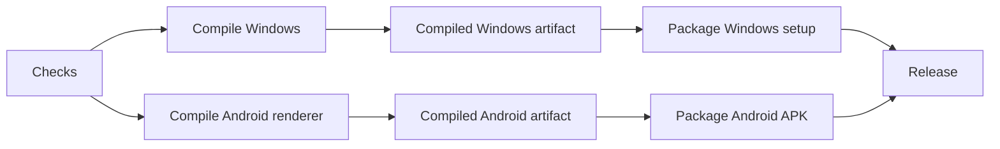

# Development and releases

## Work entirely on GitHub

Edit source files in GitHub or submit a branch/PR. Pushes to `main` and manual workflow runs execute `.github/workflows/build-fork.yml`. No local compilation environment is needed.

The workflows are:

| Workflow | Trigger | Purpose |
| --- | --- | --- |
| Release checks | Release-tooling changes, pull request or manual | Lightweight publication regressions and syntax checks, without installing the app dependencies. |
| Checks | Pull request, manual, or called by builds | Configuration validation, focused regression tests and TypeScript. Manual runs can select the full unit suite. No packages or releases. |
| Build Windows and Android | Code push to main, version tag, manual | Checks, then separate compilation and packaging jobs. Manual runs select Windows, Android or both; publishing is off by default for manual runs. |
| Publish existing build | Automatic after both packages succeed on main, or manual run ID | Verify the source commit and successful jobs, then publish existing packages. No compilation or dependency installation. |

The build graph is:

Compiled bundles and finished packages are retained as artifacts for 14 days. Packaging downloads the compiled artifact from the same run and commit. Windows runtime dependencies are installed in an isolated npm staging project using the app lockfile. Android uses Java 21 and SDK 35, generating its Capacitor host in CI and registering the local document export plugin.

If a job fails, open the run and choose **Re-run failed jobs**. Successful checks and compilation jobs are reused; GitHub restarts a failed job from its first step, not an arbitrary individual step. Dependency stores and Gradle dependencies are cached. Uploads replace an existing artifact of the same name when rerunning a job. A source change requires a new run and compilation. New pushes do not cancel an active build; documentation-only changes do not trigger packaging.

If publication alone fails, rerun that job or open **Publish existing build → Run workflow** and enter the build run ID. It accepts both successful packages and successful checks from this fork main branch, even when the overall run failed during publication. It publishes the exact built commit, uses version-specific notes, and leaves an existing public release unchanged. Artifacts must still be available. The publisher reads all attempts and uses the newest available result per job, including successful jobs reused from a prior attempt. A version that is already public is detected before downloading packages again.

See [Actions](https://github.com/n3me5is-git/chatbox-venice/actions). Open a run → job → step for its logs. Published release assets remain available until removed.

GitHub restricts release creation if the built commit has workflow files that differ from the default branch. Keep workflow definitions stable while publishing or retrying an older build; otherwise publish a fresh build from the current main branch. This is a token permission constraint, not a build failure. See [GitHub release permissions](https://docs.github.com/en/rest/releases/releases#create-a-release).

## Publish a new version

Change `release/app/package.json` and the top-level/root-package version in `release/app/package-lock.json` to the next version. Update `CHANGELOG.md` and add `docs/releases/vVERSION.md`. Commit to `main`. After tests and both builds pass, the release job creates `vVERSION`, attaches the setup, APK, updater metadata and SHA256 checksums, and uses the version-specific file as its notes. No Venice key is needed in Actions.

The release job uses the repository-scoped `GITHUB_TOKEN` with contents write permission only in that job. Build jobs use read-only repository permission.

The Windows installer is unsigned. Android uses a release-mode APK, signed with optional repository signing secrets or the existing cached CI debug key for compatibility with earlier personal installs. Cache eviction can change the fallback key. Certificate pinning and encrypted signing backup are supported; configure durable signing secrets for continuity. No private signing key is committed or uploaded unencrypted. See [personal installation and signing](personal-distribution.md).

The fork has a separate application ID and product name. Desktop updater checks only this fork's GitHub release feed. Android updates are downloaded and installed manually from the fork's release page.

## Optional local development

Use Node 22.14 and the package-manager version pinned in `package.json`. `pnpm install --frozen-lockfile`, then `pnpm dev` for Electron or `pnpm dev:web` for the browser. Local source, dependencies and package caches commonly require several GB; allow roughly 5–10 GB total and 15 GB free as a practical margin. This is an estimate, not a measured full installation.

A browser preview can have CORS limits that differ from the native apps. Final release packages are built by Actions. Android Studio/SDK and Java are unnecessary unless you choose to debug the native Android host locally.

See [simulated UI and functional testing](fork-testing.md) for isolated Checks runs and screenshot artifacts.

## Validation boundaries

Provider tests use mocked API responses, including streaming citations, moderation, model discovery, native editing and request cancellation. They do not make billable Venice calls. A successful build proves packaging, not successful inference with every model or behavior on every Android device. Test the downloaded packages with your own key before relying on them.

Reference implementations: [Venice CLI](https://github.com/veniceai/venice-cli), [Venice MCP](https://github.com/veniceai/venice-mcp-server), and [Venice API documentation](https://docs.venice.ai).
