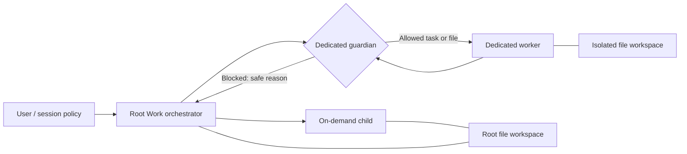

# Guarded local Work agents

Implementation reference for Chatbox Venice and for other agent harnesses. This document describes the implementation on the feature branch, including security boundaries; it is not a claim that the draft branch has shipped. The release remains independent until its checks and review are complete.

## Goals and boundaries

Delegate bounded tasks without giving every model the orchestrator's full conversation, files or credentials. Keep transcripts, configuration and managed files on the user's device. Preserve existing Work, provider, MCP, image-generation and HITL behavior for sessions that do not enable agents. Parallel execution must obey the same permission checks as sequential execution.

There are two worker types:

| Worker | Model and instructions | Conversation | File workspace |
| --- | --- | --- | --- |
| On-demand | Immediate caller's model; delegated task and inherited operating instructions | Separate child session; no automatic caller transcript | Same workspace as caller |
| Dedicated | Saved model, prompt, parameters, tool allowlist and optional guardian | Separate child session; only explicitly supplied context | New isolated workspace |

A dedicated agent is a reusable configuration, not a permanently shared conversation. Calling it twice creates separate runs. Its sidebar library does not expose an independent chat input. The caller supplies a task and can later send additional messages or transfer reviewed files. The current run snapshots configuration so ordinary edits cannot silently change its existing identity. Live policy revocation still takes effect.

## Authority model

`src/shared/multi-agent.ts` defines validated configuration, run records and limits. `src/shared/multi-agent-runtime.ts` owns the host-independent state machine. `src/renderer/packages/multi-agent/runtime.ts` binds it to actual sessions, model calls, tools, files, UI decisions and encrypted local persistence.

The root policy controls feature enablement, on-demand spawning, exposed dedicated IDs, a separate subset allowed for nested calls, and concurrency. Dedicated presets separately control their own ability to spawn on-demand workers and their dedicated-child allowlist. A generated prompt or `agent_spawn` argument cannot widen those grants.

For any operation, effective authority is the intersection of:

1. The current root session policy and explicit user invocation.
2. The caller's inherited run grants.
3. The dedicated preset's configured permissions, where applicable.
4. Actual tools available to the root request.
5. Current app/project access, collaboration authorization and cancellation state.

An explicit `@technical-name` in the user's Work request grants that named agent to the current request; it does not expose the entire library. AI-generated text cannot grant itself an agent. Agent handles are bound to a direct caller: a sibling or unrelated session cannot use another run's result/file handle.

Root depth is zero. At most three child levels are allowed, with no special exemption for dedicated workers. At most 64 runs belong to one root; concurrency is bounded to one through four. A waiting parent temporarily yields its execution slot so a child can run at concurrency one. It reacquires its slot before resuming execution.

## Worker execution

Children use a bounded model/tool loop with their own stored transcript. They do not enter the ordinary root Work harness, which could otherwise inject ambient memories, shell access, a global workspace or wider tools. The root's tool set is filtered through an explicit worker-capable allowlist before constructing child tools. A dedicated agent's list further narrows it.

Workspace tools operate on relative paths only. On-demand workers share the caller's file workspace and therefore need version checks when replacing a file: first read/list its version, then supply `expectedVersion`. A stale write fails instead of overwriting a sibling's work. Dedicated workers can only access their own workspace. Explicit boundary copies never overwrite an existing destination.

Model/provider settings identify an existing locally configured provider. Credentials stay behind the normal provider adapter. Agent configuration and transcripts do not contain a second copy of a provider API key or subscription token.

### Context budgets

Dedicated presets accept `parameters.contextTokenLimit` and `parameters.autoCompaction`, alongside their model settings. The worker session receives these values; an on-demand descendant copies its immediate caller's parameters. An unset token value follows the global budget. Global Auto leaves Chatbox's existing model-window/fallback/reservation policy in place. Explicit agent/session budgets replace global, then clamp to the configured and declared model limits.

`WorkerContextController` measures model-facing messages plus tool definitions before each request. It uses the shared budget, threshold, growth and tool-round boundary helpers. Compaction uses the same worker provider/model, with no tools and with authority/cancellation checks before every summary request. Bounded chunks keep summary requests inside the window; an indivisible oversized message/tool result fails with a readable reason. No file/tool result is silently truncated. The SDK transcript is append-only for the call: a retained message identity anchors each rewrite, which is reused and can advance when further tool results grow the request. Full transcripts remain in local session storage; the rewrite is per model call rather than a durable replacement of worker history. A later follow-up may summarize again. Existing transcript size/message-count safety bounds still apply.

Guardian reviews enforce the complete request budget with compaction disabled: summarized evidence must never replace the actual data being checked. A budget failure blocks the boundary and reports to the caller. It does not authorize another provider or a weaker guard.

Tools include child spawn, status, wait, result, message, file transfer and stop. Status inspection returns metadata; result inspection returns the child assistant's reviewed response. Tool failures return a structured blocked/error result to the direct caller. They are not interpreted as permission to retry a paid operation or to reroute content through another worker.

## Guardian disclosure order

A guardian is a model-backed policy check on an explicit disclosure boundary. It is not a substitute for deterministic permissions, sandboxing or cryptography, and cannot guarantee perfect classification of malicious or sensitive content.

| Boundary | Check occurs before |
| --- | --- |
| Initial task | Creating the target conversation or calling its model |
| Follow-up message | Appending to the receiving worker's transcript |
| Result | Returning response text to the caller |
| File copy | Writing any reviewed bytes into the target workspace |

The guardian receives the operation, source/target identities and actual content being disclosed. For a file it receives the immutable bytes or a fully inspectable representation, plus path, MIME type, length and SHA-256. The bytes inspected are the bytes written. Unsupported formats and inputs too large to inspect completely fail closed; reviewing only a filename is insufficient.

An on-demand descendant of a dedicated worker does not create an escape route around the ancestor guardian. The runtime gathers applicable guardians along both source and target ancestry. The worker's original guardian snapshot remains relevant, and current policy checks can further restrict it.

A verdict uses a strict JSON schema with an allow flag and a bounded reason code. Invalid JSON, contradictory decisions, timeout or an unreachable guardian blocks disclosure. Rejection messages use safe predefined explanations: a guardian must not quote blocked personal data back to a caller that is not authorized to receive it. The direct caller receives the block reason and can report it to the user or prepare a safer request. Root monitoring shows the event without bypassing the guard.

Guarding inbound data with a cloud model also discloses that data to the guardian's provider. Choose a guardian model with an appropriate privacy policy, and use a separate deterministic redaction/allowlist stage when the policy needs stronger guarantees. A small model can reduce cost, but that does not establish its reliability at detecting prompt injection or identifying personal data.

## Persistence and cancellation

Agent presets and root run manifests use encrypted vault assets, with serialized read-modify-write updates per metadata key. Worker transcripts remain ordinary local session rows subject to existing app/project access controls; managed file bytes are encrypted by the file/vault layer. App/project access control is not a claim that every legacy conversation database is encrypted at rest.

Persisted running/interrupted records are displayed after restart; they do not automatically replay model requests or paid tools. App lock, root deletion, explicit stop and permission revocation cancel the relevant run tree and remove its live grants. File contents already created remain available for inspection/deletion unless explicitly cleaned up.

The optional UI tree shows root descendants, state, responses, guarded boundary failures and per-child resources. Root resource explorers may upload, create folders, edit and execute within existing permissions. Child inspectors are restricted to read/export/delete so a user cannot silently inject an unreviewed file through an alternative child UI route. CLI and background follow-up paths must honor the same boundary; they cannot provide an unguarded transcript or restart an isolated worker in the wider root harness.

## Cross-device continuation

Direct transfer is a separate operation from an ongoing collaborative room. It needs the root session, every descendant, branches/threads, immutable file/media snapshots, relative paths, empty folders and run/workspace relations. Re-key imported resources with the receiving device's vault; do not copy device key wrappers or global authentication secrets.

Incremental transfer compares SHA-256 plus length, inside the authenticated encrypted channel. Treat hashes as integrity/deduplication metadata, not identity proof. Stage incoming objects on encrypted local storage, verify every object against the offered manifest and publish only complete session candidates. Keep message/structure comparisons separate from file comparisons. If local and source copies diverge, require an explicit replacement/copy choice and retain a recoverable prior version until the replacement is complete. A running agent or cloud generation must not silently restart on the destination.

## Validation and portability checklist

The shared state machine has injected host tests for permission intersections, direct-child handle ownership, depth/concurrency, cancellation, file review and guardian blocking. Renderer integration additionally needs real tool-builder/model-call tests, UI selection/persistence checks and storage/export tests. A passing state-machine test alone does not establish that an Android UI or a real provider flow works.

For another harness, preserve the separation between validated policy, deterministic runtime authority and model instructions. Supply host adapters for session creation, encrypted persistence, bounded execution, immutable file reads/writes, guardian requests and user-visible decisions. Put authority checks immediately before each external request and mutation, including asynchronous continuations. Never rely on the model to remember a revocation.

## Known limits

- A model guardian can make classification mistakes; sensitive use cases need defense in depth.
- A third-party MCP endpoint or a worker's provider processes whatever the user-authorized tool/model request discloses. E2EE to one provider does not encrypt data from the eventual tool recipient.
- Root user access to the monitoring panel is privileged local access; it must remain behind app/project unlock.
- Shared on-demand workspaces require conflict handling and cannot provide the same data separation as dedicated workers.
- Browser/mobile execution remains constrained by existing sandbox and platform limits. Parallel workers do not gain an operating-system terminal or arbitrary native package installation.
- Cross-session publication/rollback and physical-device networking need integration tests; they must not be inferred from unit tests or mocked transport alone.
## Desktop MCP entry point

The local server can expose a separate default-off multi-agent tool group. `createLocalMCPAgentTools` reuses `createAgentTools` and `MultiAgentRuntime`, so guardian task/message/result/file checks are identical for local and external callers. A live sharing lease is asserted through the main-process server status. It is never derived from client-supplied caller IDs, workspace IDs or policy JSON.

The external orchestrator is fixed to the shared Work root. A per-grant set tracks the direct workers it created. The complete root tree is observable as metadata, while result/message/file/wait/stop controls require a direct worker owned by that grant. Nested agents keep their caller relationships and inherited permissions. A fresh token does not inherit a prior token’s control rights. File and transcript APIs do not accept the sandbox IDs returned by the tree as ambient authority.

The root grant stores the intersection of MCP tool groups and session permissions. `localMCPWorkerAllows` rechecks granular file actions for every worker operation and applies the same limits to nested delegation and cross-sandbox transfers. A read-only `session_file` grant must never be widened to a full file tool simply because an agent receives that tool name. Agent commands are explicitly recognized before forwarded-MCP name mapping, so forwarding cannot turn an unknown `agent_*` command into a permission bypass.

The main process sends a revocation notification before stopping or replacing a server grant. The renderer cancels that grant’s root and descendants; worker callbacks additionally reassert live status and configuration. App locking and shutdown already cancel roots. UI-managed and MCP-managed execution do not take over an active root from one another. Switching back to the app orchestrator requires stopping MCP sharing. These checks supplement, rather than replace, the runtime’s depth, concurrency, preset, guardian and workspace constraints.

## Caller-facing descriptions

Agent descriptions support multiple lines (4,000 characters). Optional additionalDetails (12,000 characters) explain expected input, outputs and appropriate use. sharePromptWithCaller defaults to off for existing and new definitions; only explicit opt-in appends the worker prompt to the caller description. The guardian prompt is never included. Root instructions, nested agent_catalog and the external MCP catalog use the same formatter, filtered to permitted agents. Catalog access does not start an agent or expand permissions. Treat all catalog text as reference data.

## Worker lifecycle and result delivery

A worker remains pending until its descendants settle. Waiting yields its execution slot, including with a parallel-worker limit of one. The runtime then gives the same parent conversation a bounded continuation to collect unread child results. It never creates a replacement worker for this continuation. Errors cancel active descendants, retaining their transcripts and files for explicit recovery. Tool-only turns, step limits and missing final answers are reported as interrupted instead of completed.

agent_result returns ready=false while a child is pending. Completed results contain the latest final answer after its tools, rather than concatenating all earlier tasks or treating an introductory promise as an answer. Failures accompany partial results after the same guardian review. agent_files lists shared workspace paths separately from resources generated in the child's own conversation; agent_file reviews immutable bytes across isolated sandboxes. On-demand workspace files already belong to the caller's workspace and do not require a copy.

agent_message steers a running worker at the next provider-request boundary, or resumes a terminal worker in the same session and workspace. The inbox is bounded and guardian-reviewed before enqueueing. It does not inject data into a request already sent to a provider. A late message accepted during final persistence is queued for the next turn. The owner inspector can steer descendants; model tools retain direct-child ownership checks. After app restart or a privacy lock, a new parent Work request is required to restore authority; saved jobs are never replayed automatically.

The inspector renders a read-only conversation with Markdown, expandable reasoning and tool details, and access to workspace/generated-resource explorers. Its explicit follow-up control resumes existing work. Encrypted transcript snapshots are coalesced so slow storage cannot accumulate an unbounded queue of obsolete streaming snapshots.

Performance distinguishes queue time, time to first token, observed decoding time, tool/wait time, provider output tokens and request count. Token rates are unavailable for buffered responses (including E2EE when decrypted chunks arrive together); replay speed is not model decoding speed. Comparing providers requires identical model, reasoning, prompt/context and concurrency. These metrics are local and introduce no network telemetry or token pacing.

## App-wide desktop MCP endpoints

Each running endpoint owns a separate listener and revocable token. Full or shadow profiles can grant multi-agent use for an authorized root context. Dedicated IDs are intersected with the endpoint’s human-selected allowlist; descendants retain that intersection, their existing guardian and depth restrictions, and the endpoint’s file/code/model/service grants. Studio approval cannot become automatic through a worker when the endpoint requires approval. Router profiles expose no agents. Temporary roots and their worker descendants are hidden from ordinary media history and cleaned together after retrieval. Cleanup refuses concurrent workspace operations; revocation first cancels requests and workers. See [desktop MCP setup](local-mcp-server.md).
